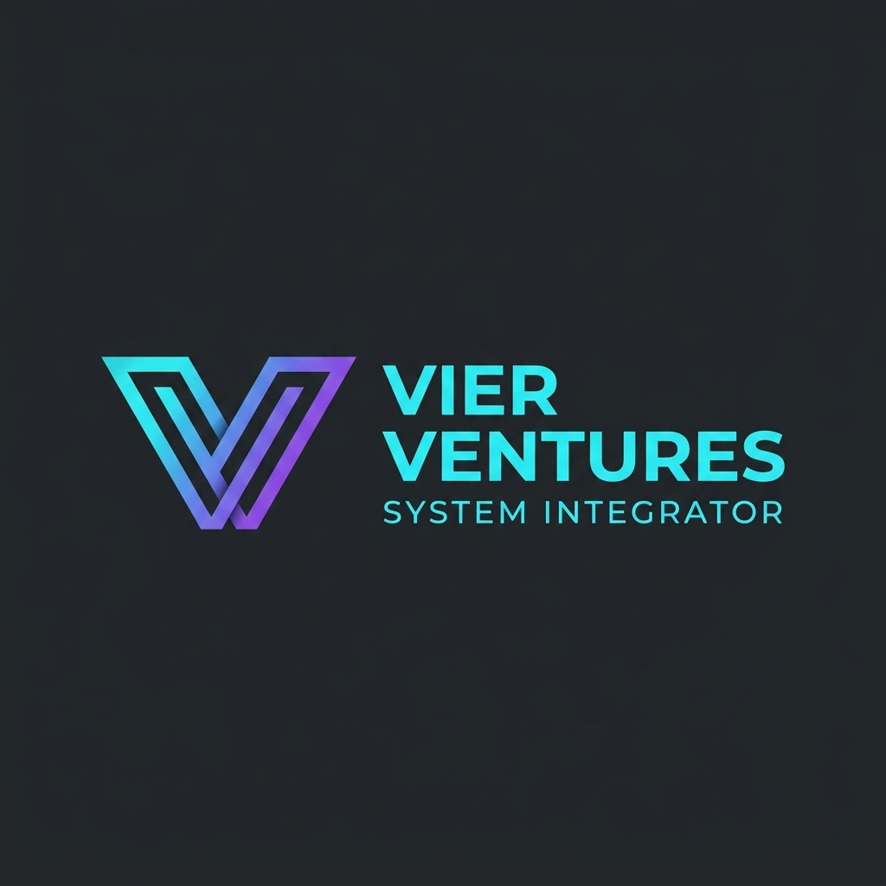
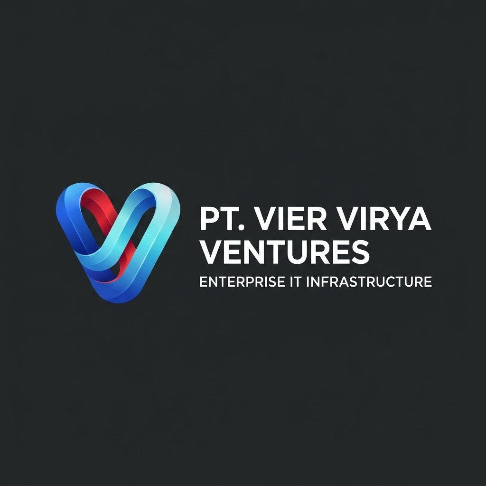
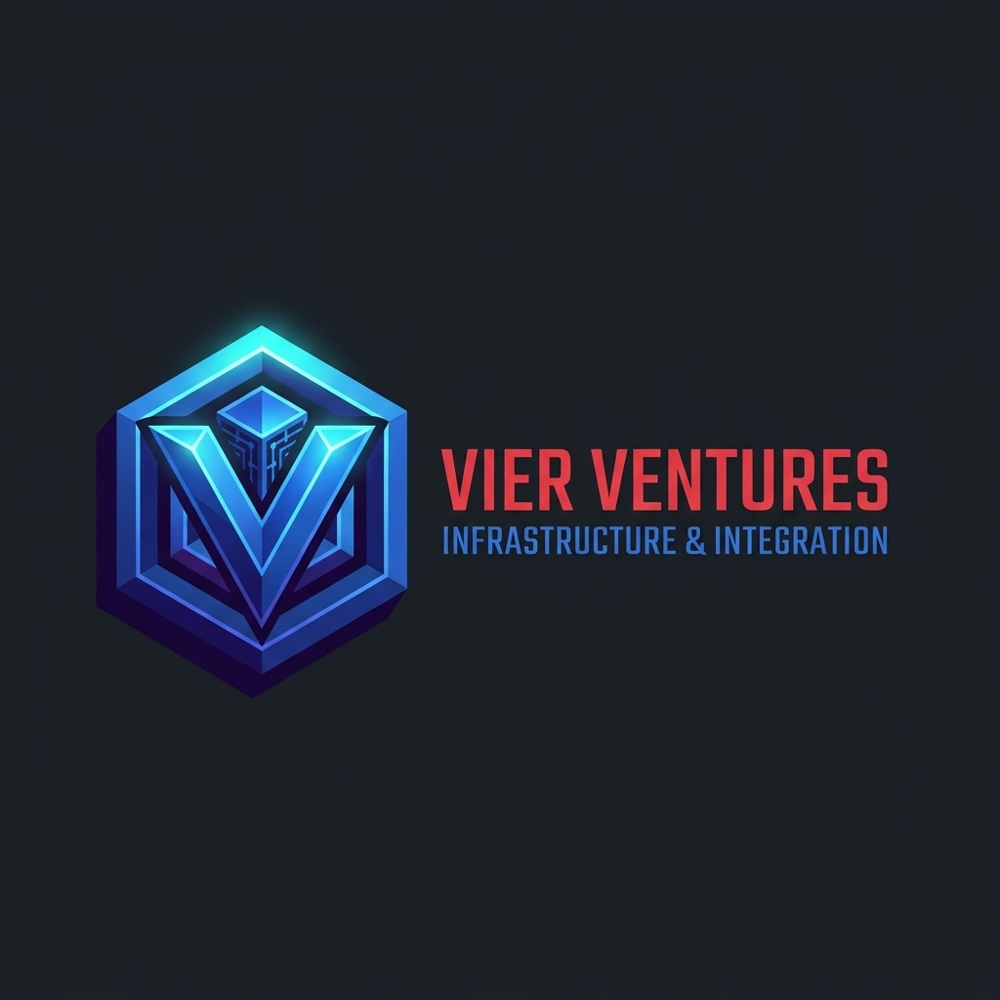
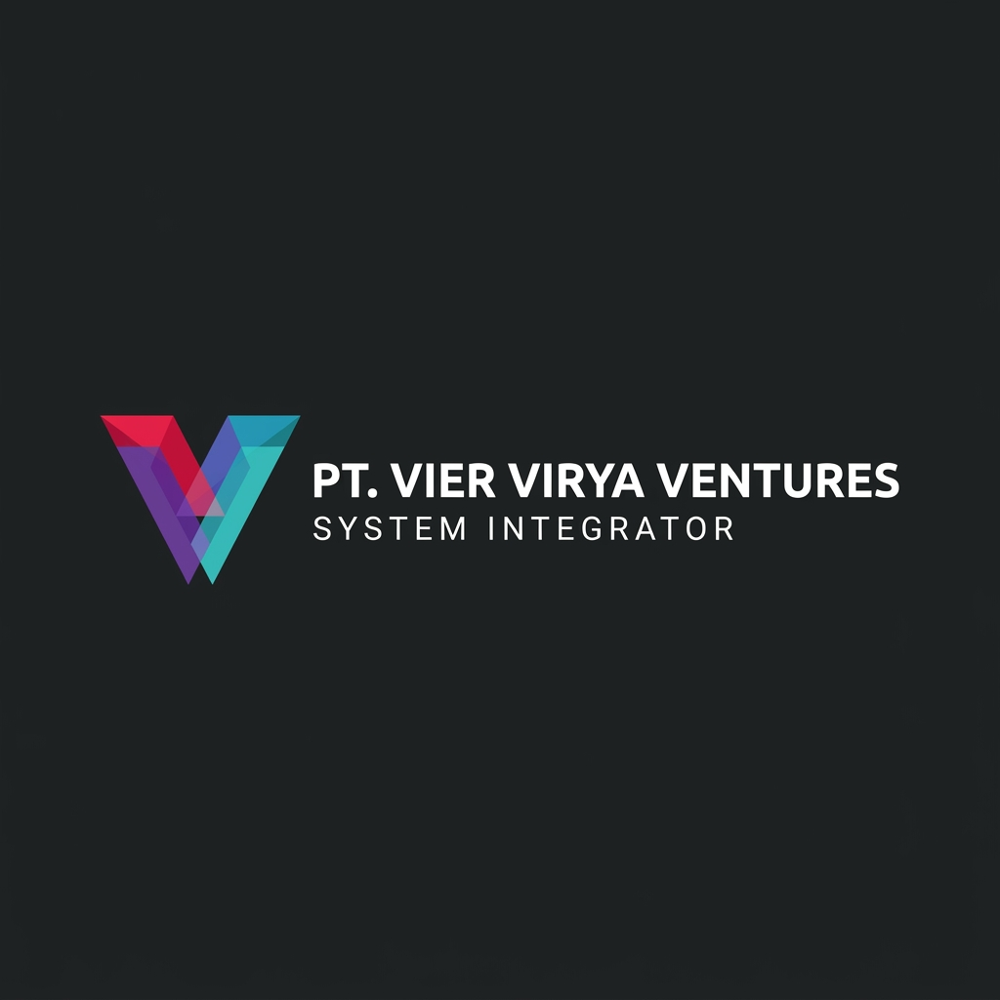
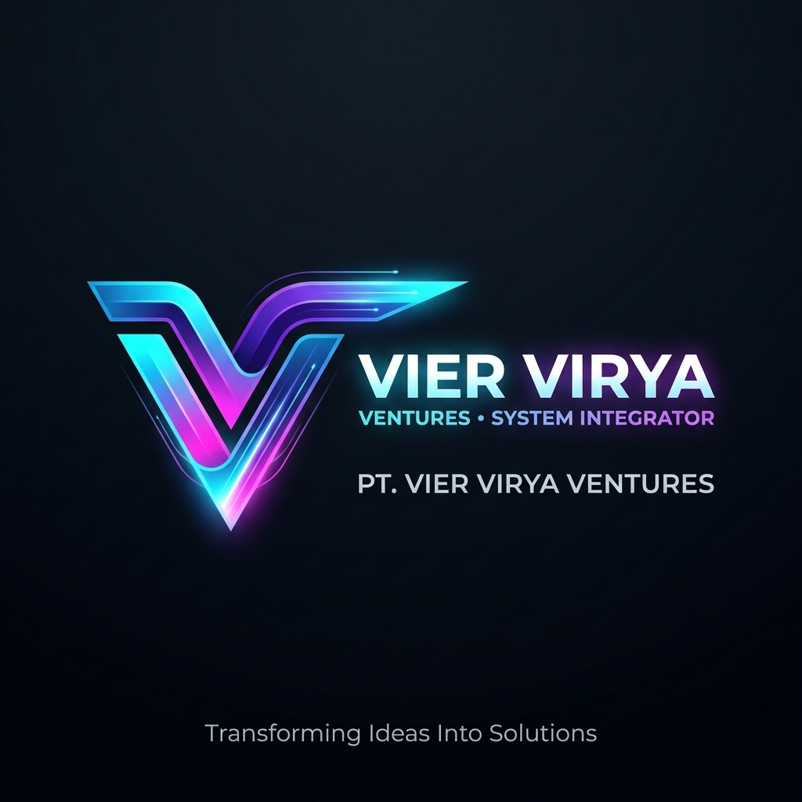

# 5 Opsi Redesain Logo PT. Vier Virya Ventures

Berikut adalah 5 opsi konsep redesain identitas visual korporat untuk **PT. Vier Virya Ventures** (System Integrator & Enterprise IT Infrastructure). Setiap opsi dirancang secara terarah dengan mempertahankan karakter teknologi dan filosofi kepemimpinan infrastruktur, namun dengan eksekusi visual modern, berwibawa, dan siap pakai untuk berbagai media korporat.

---

### Opsi 1: The Dual V Monogram (Geometric Precision & Fiber Network)

- **Konsep Arsitektural**: Monogram ganda huruf V yang saling bertaut erat (melambangkan sinergi *Vier* dan *Virya*). Garis-garis geometris presisi bersudut 45 derajat menyerupai struktur jalur kabel serat optik (*structured cabling*) dan switching core.
- **Gradasi Warna**: *Electric Cyan* ke *Luminous Violet*. Sangat kontras dan tajam pada latar belakang gelap (*dark mode*) maupun terang.
- **Karakter Brand**: Presisi, kokoh, berwibawa, simetris, dan mencerminkan rekayasa teknis tingkat tinggi.
- **Rekomendasi Penggunaan**: Sangat ideal untuk branding peralatan hardware, kop surat tender resmi kementerian/korporasi, sertifikat instalasi, dan signage kantor pusat.

---

### Opsi 2: Dynamic Data Convergence (Infinity Ribbon V)

- **Konsep Arsitektural**: Pita multidimensi tiga dimensi yang meliuk membentuk huruf V dinamis menyerupai simbol *infinity*. Menggambarkan sirkulasi data 24/7 tanpa henti (*zero downtime SLA*) dan konvergensi seluruh pilar IT (Network, Data Center, Security, Wireless).
- **Gradasi Warna**: Mengadaptasi warna esensial logo asli (Merah Ruby, Biru Kobalt, dan Cyan Elektrik), namun dipadukan dengan teknik bayangan aerodinamis modern.
- **Karakter Brand**: Dinamis, fluid, modern, ramah namun tetap berkelas enterprise.
- **Rekomendasi Penggunaan**: Tampilan website, aplikasi portal manajemen telemetry client, ID card tim teknis, dan polo shirt seragam engineer.

---

### Opsi 3: The Architectural Hexagon Core (Infrastructure Shield & Datacenter)

- **Konsep Arsitektural**: Lambang heksagonal kokoh berkarakter perisai (*shield*) dengan huruf V isometrik di tengahnya yang ditopang oleh pilar microchip dan simpul jaringan. Merepresentasikan proteksi siber fisik terintegrasi serta kestabilan rak data center.
- **Gradasi Warna**: *Deep Sapphire Blue*, *Cyber Cyan*, dan pendaran cahaya *violet node*.
- **Karakter Brand**: Tangguh, aman, andal, mission-critical, dan tahan banting.
- **Rekomendasi Penggunaan**: Brosur pengadaan Data Center Tier 3, segel garansi server rack, armada kendaraan teknisi lapangan, dan proposal tender sistem keamanan.

---

### Opsi 4: Minimalist Swiss Style Prismatic Chevron (Executive & Global SI)

- **Konsep Arsitektural**: Evolusi paling bersih dan minimalis (*pure vector geometry*). Tiga bidang sudut transparan yang saling bertumpuk rapi membentuk chevron V. Setiap irisan bidang melambangkan transparansi kerja, integritas pengadaan, dan kemitraan global.
- **Gradasi Warna**: Aksen *Ruby Crimson*, *Electric Indigo*, dan *Teal Cyan* transparan.
- **Karakter Brand**: Elegan, bersahaja, berkelas internasional (sekelas Fortune 500 tech consulting), sangat abadi (*timeless*), dan mudah direproduksi dalam cetakan satu warna.
- **Rekomendasi Penggunaan**: Kartu nama eksekutif direksi, profil perusahaan resmi, favicon website, plakat penghargaan, dan neon box gedung perkantoran.

---

### Opsi 5: Quantum Fiber Wings (Forward Momentum & Smart Building)

- **Konsep Arsitektural**: Dua sayap optik aerodinamis dengan sudut lancip mengarah ke kanan atas, melambangkan momentum pertumbuhan bisnis, kecepatan transmisi data nirkabel WiFi 6/7, dan otomatisasi gedung pintar.
- **Gradasi Warna**: Pendaran neon magenta, violet, dan cyan terang dengan detail garis trace sirkuit.
- **Karakter Brand**: Progresif, visioner, berorientasi teknologi masa depan (*Invest in Technology for Future*), energik.
- **Rekomendasi Penggunaan**: Presentasi tender inovasi smart IoT, digital marketing, signage fasilitas hospitality dan kampus.

---

### Ringkasan Panduan Pemilihan

| Opsi | Fokus Filosofis | Gaya Visual | Kekuatan Utama |
|---|---|---|---|
| **Opsi 1 (Dual V)** | Sinergi & Integrasi Sistem | Monogram Geometris | Sangat berwibawa & presisi teknik |
| **Opsi 2 (Infinity Ribbon)** | Ketersediaan Data 24/7 | 3D Dimension Ribbon | Mengangkat DNA warna asli logo |
| **Opsi 3 (Hexagon Core)** | Keamanan & Fasilitas Data Center | Isometric Shield | Tampilan tangguh & terproteksi |
| **Opsi 4 (Prismatic Chevron)** | Kelas Eksekutif Internasional | Swiss Style Minimalist | Sangat abadi, bersih & serbaguna |
| **Opsi 5 (Quantum Wings)** | Kecepatan Serat Optik & Masa Depan | Futuristic Tech Wings | Dinamis, futuristik & berenergi tinggi |
